

  <a href="README.md">English</a> · <strong>Español</strong>

# 🧳 SOC in a Box

### *Un entorno de red corporativa a pequeña escala conectado a un Centro de Operaciones de Seguridad externo para probar ingeniería de detección activa*

🔗 **[Demo en vivo](https://albeen-sknight.github.io/soc-in-a-box/)**

---

Monté una pequeña empresa en mi PC, le puse al lado un centro de operaciones de seguridad (SOC) y luego entré a robar en mi propia empresa para ver si me pillaba a mí mismo.

> 🟩 **Estado: Terminado**
> La empresa y el SOC están totalmente montados y funcionando. Las **diez detecciones** están hechas. Nueve saltan con un ataque real en vivo y me avisan al móvil. La décima se topó con una defensa del sistema que corta la amenaza por completo antes de que genere telemetría, lo cual representa una victoria por derecho propio.

Esta página cubre la historia entera desde la configuración de la arquitectura hasta la ejecución de ataques y la lógica de las búsquedas.

## Qué es esto

### En palabras sencillas
Imagina una oficina pequeña con un servidor que comprueba los inicios de sesión de todo el mundo, un par de portátiles del personal y una tienda web. Cada uno de ellos manda un aviso a una sala de cámaras cada vez que pasa algo. Yo estoy en la sala de cámaras. Luego hago de ladrón, entro de varias maneras distintas e intento pillarme a mí mismo como lo haría un analista SOC en un turno de verdad.

### En palabras técnicas
Un controlador de dominio con Windows Server, dos estaciones de trabajo con Windows 11 y un servidor web con un WAF, todo corriendo en mi PC. Sus registros de Windows Security, Sysmon, PowerShell y ModSecurity salen de la red del laboratorio y viajan hasta Splunk Enterprise, que corre en Docker en el mismo PC pero fuera de la red de la empresa. Lanzo técnicas mapeadas a MITRE ATT&CK contra el laboratorio, mis detecciones en SPL levantan alertas que me hacen vibrar el móvil, y trabajo cada alerta como lo haría un analista junior.

## Sobre mí

Soy Albeen. Estoy estudiando administración de sistemas de red y quiero empezar mi carrera como analista SOC. Antes de esto hice un programa de prácticas de CyberSOC y labs guiados de Elastic y Kibana, y construí [WAF Flight Recorder](https://github.com/albeen-sknight/waf-flight-recorder), un firewall de aplicaciones web que desplegué, ataqué y ajusté yo mismo. Ese proyecto es la tienda web de este.

## Por qué lo monté

Quiero trabajar como analista SOC, el que está en la silla mirando las alertas, decidiendo cuáles son reales y persiguiendo las que lo son. El problema de aprender eso con labs guiados es que otra persona ya ha montado la empresa, ha plantado el ataque y te da los logs limpios. Acabas practicando cómo leer la respuesta, no cómo encontrarla.

Así que lo monté todo yo. Levanté la empresa, un dominio pequeño de Windows con personal, estaciones de trabajo y una tienda web. Puse el SOC al lado y conecté cada máquina para que mandara sus logs. Escribí las detecciones y mapeé cada una a MITRE ATT&CK. Luego hice de atacante, lancé cada técnica a propósito y me senté en la silla a ver si mis propias alertas me pillaban.

Esta es la segunda parte de una historia que empecé con [WAF Flight Recorder](https://github.com/albeen-sknight/waf-flight-recorder), donde construí y ataqué un firewall web. Ese firewall es la tienda web de aquí, WEB01, y sus logs entran en este SOC. Una empresa, dos proyectos, una historia: el firewall bloquea el ataque, el SIEM se da cuenta del patrón.

La idea nunca fue juntar diez búsquedas que funcionan. Era entender la cadena entera, desde el comando que escribe un atacante, hasta la línea de log que deja, hasta la alerta en mi móvil, para poder explicar cualquier parte en voz alta. Esa es la parte del trabajo que no puedes fingir en una entrevista.

## La empresa: Limonada S.L.

Limonada S.L. es un distribuidor de zumos inventado con 40 empleados. Es la misma empresa que lleva la tienda web que protegí en mi proyecto del WAF, así que los dos proyectos cuentan una sola historia.

| Máquina | Qué es | Vive en |
| --- | --- | --- |
| DC01 | Windows Server 2025, el controlador de dominio de `limonada.local` | PC |
| WS01, WS02 | Estaciones de trabajo con Windows 11 Enterprise | PC |
| WEB01 | La tienda web detrás del WAF de mi proyecto anterior | PC |
| Atacante | El invitado que nadie llamó, apuntando solo a máquinas del laboratorio | PC |
| El SOC | Splunk y el relé de alertas en Docker, fuera de la red del laboratorio | PC |
| El busca | Las alertas llegan como notificaciones al móvil | Móvil |

La empresa vive en una red privada de VMware y el SOC vive fuera de ella, en Docker. Así es también como funciona un SOC gestionado en la vida real: está fuera de la red del cliente y los logs viajan hasta él.

## El SOC se pone en marcha

Piensa en el SOC como un almacén que solo acepta entregas cuando tiene los muelles de carga listos. Lo primero que necesitaba era un sitio donde aterrizaran los logs. Splunk corre en Docker en mi PC, con cuatro cajones preparados: uno para eventos de Windows, uno para Sysmon, uno para la tienda web y uno de reserva para Linux.

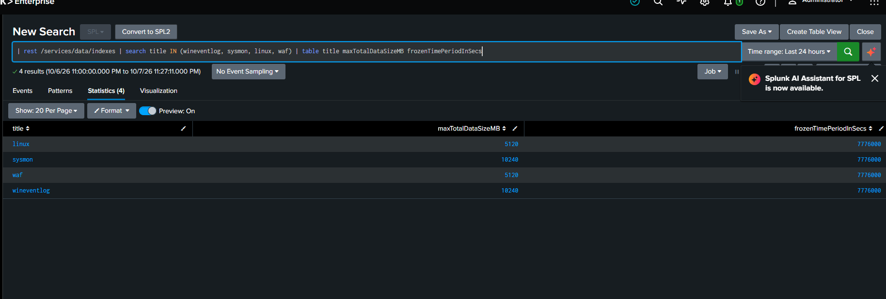

Los eventos de Windows en crudo son un muro de números, así que Splunk necesita dos apps pequeñas para entenderlos. Aquí están, instaladas.

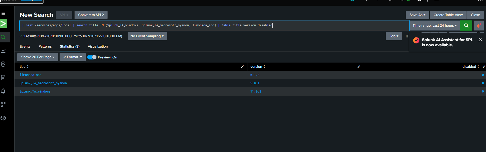

Una vez que las máquinas tenían sus forwarders, los eventos empezaron a llegar solos, desde el controlador de dominio y las dos estaciones de trabajo.

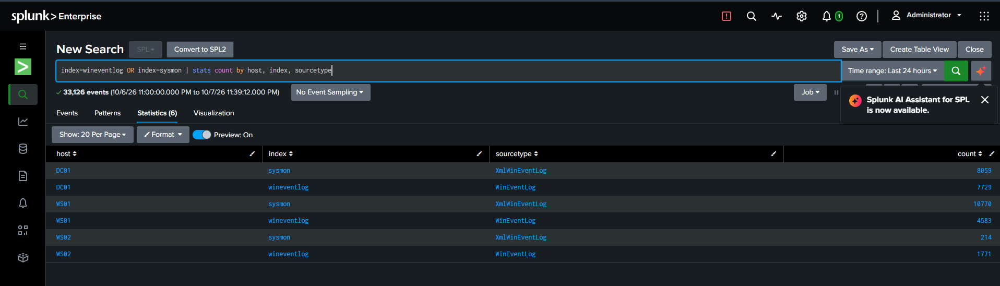

Esta es la pantalla que miro cuando me siento: inicios de sesión fallidos, cambios de admin, bloqueos del WAF, todo en un sitio.

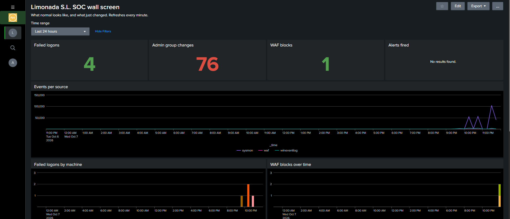

## Las diez detecciones

Cada detección es una búsqueda SPL guardada que se ejecuta cada minuto sobre los últimos quince, mapeada a una técnica de MITRE ATT&CK. Las serias me avisan al móvil. Las más tranquilas se quedan en el dashboard como contexto, para que el aviso siga teniendo sentido. Cada una de abajo tiene su explicación completa en [`detections/`](detections) con la búsqueda, los falsos positivos, lo que se le escapa y cómo la probé.

| # | Detección | ATT&CK | Severidad | Estado |
| --- | --- | --- | --- | --- |
| D01 | [Muchos inicios de sesión fallidos y luego uno correcto](detections/D01-failed-logons-then-success.md) | T1110 | Alta, avisa | Salta, avisó |
| D02 | [Password spray desde un mismo origen](detections/D02-password-spray.md) | T1110.003 | Alta, avisa | Salta, avisó |
| D03 | [Alguien añadido a un grupo con privilegios](detections/D03-added-to-admin-group.md) | T1098 | Alta, avisa | Salta, avisó |
| D04 | [Cuenta local nueva creada](detections/D04-new-local-account.md) | T1136.001 | Media | Salta |
| D05 | [PowerShell codificado u oculto](detections/D05-encoded-powershell.md) | T1059.001 | Alta, avisa | Salta, avisó |
| D06 | [Un proceso abriendo la memoria de LSASS](detections/D06-lsass-access.md) | T1003.001 | Crítica, avisa | Hecha, frenada por una defensa |
| D07 | [Tarea programada nueva](detections/D07-new-scheduled-task.md) | T1053.005 | Media | Salta |
| D08 | [Registro de seguridad borrado](detections/D08-security-log-cleared.md) | T1070.001 | Crítica, avisa | Salta, avisó |
| D09 | [Office lanzando una shell](detections/D09-office-spawns-shell.md) | T1204.002 | Alta, avisa | Salta, avisó |
| D10 | [El WAF bloquea y luego deja pasar una](detections/D10-waf-blocks-then-success.md) | T1190 | Alta, avisa | Salta, avisó |

Las voy a recorrer en el orden en que un intruso las iría pisando de verdad, desde llamar a la puerta hasta borrar sus huellas.

### Entrar

**D01, muchos inicios de sesión fallidos y luego uno correcto.** Imagina a alguien delante del teclado metiendo mal la contraseña de una cuenta una y otra vez, hasta que por fin acierta. Eso es lo que pilla esto: diez o más fallos en una cuenta y luego un acierto. En mi prueba fue `lucia.navarro`, 27 fallos y luego un inicio de sesión, y un minuto después me vibró el móvil.

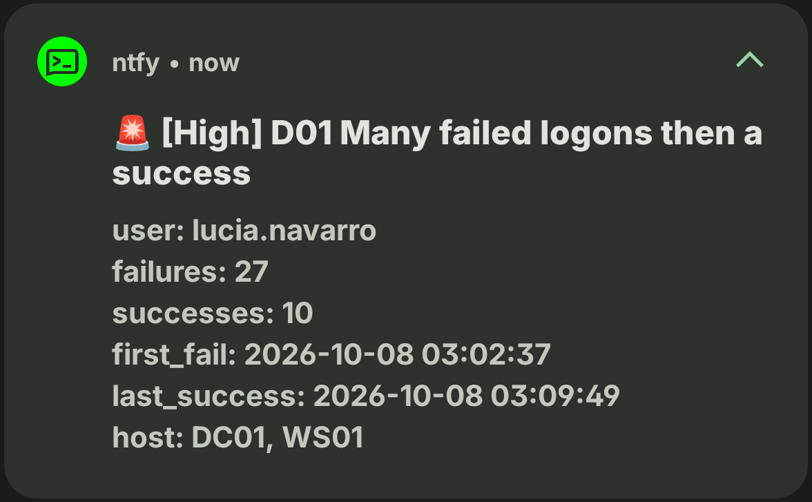

Montándola salió mi primer hallazgo de verdad: `limonada.local` no tiene política de bloqueo de cuentas. Nada frena los intentos después de diez, así que esta alerta es lo único que vigila esa puerta. Lo apunté en vez de arreglarlo sin más, porque darse cuenta del agujero es parte del trabajo.

**D02, un password spray.** Esto es D01 al revés. En lugar de muchas contraseñas contra una cuenta, es una contraseña probada contra muchas cuentas, que es como un atacante esquiva el bloqueo. Lancé el spray contra 15 cuentas desde WS01 en unos segundos, y la detección lo juntó en una sola fila: un origen, 15 cuentas distintas, por encima del umbral.

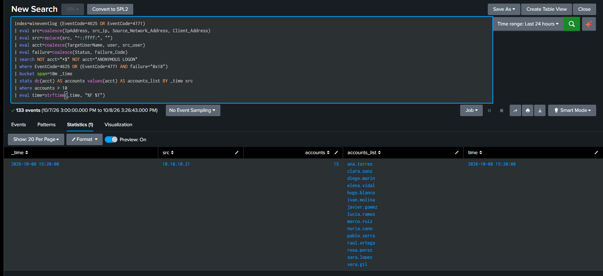

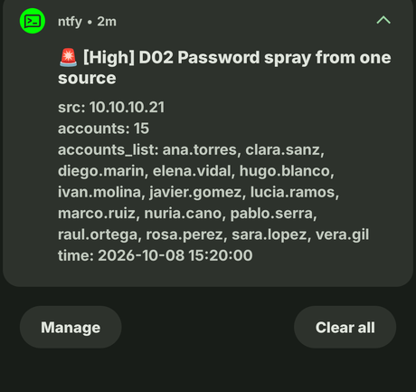

### Afianzarse

Una vez dentro, se ponen cómodos: más permisos, una vía de vuelta de reserva, algo que sobreviva a un reinicio.

**D03, añadido a un grupo con privilegios.** Este es el momento en que un intruso deja de ser un invitado y se da las llaves. Vigila tres eventos, no uno, porque añadir a los grupos Administradores local, Domain Admins y Enterprise Admins se registra de forma distinta en cada caso. Añade una cuenta a admins y me suena el móvil.

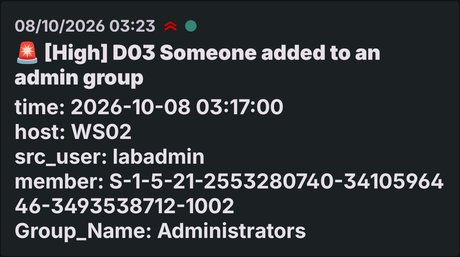

**D04, una cuenta local nueva.** En un PC de empresa la gente entra con cuentas de dominio. Una local recién creada es la forma clásica y silenciosa de dejarse una puerta abierta, porque no aparece en Active Directory. Por sí sola, una cuenta local nueva muchas veces es inocente, así que esta es Media y se queda en el dashboard. La versión peligrosa, una cuenta nueva que luego consigue permisos de admin, es lo que avisa D03.

**D07, una tarea programada nueva.** Una tarea programada es de las formas más fáciles de hacer que algo vuelva a ejecutarse tras un reinicio, por eso a los atacantes les encantan. El truco del que estoy orgulloso aquí es filtrar por *quién*, no por *dónde*. Windows crea sus propias tareas con la cuenta del equipo, así que dejándolas fuera se quita todo el ruido y aun así se pilla una tarea que esconda una persona, incluso dentro de una carpeta de Windows.

### Ejecutar código que no deberían

**D05, PowerShell codificado u oculto.** El malware casi nunca lanza un comando legible a secas. Esconde la carga detrás de base64 o de una ventana oculta. Esta pilla las dos cosas, y es la que me enseñó la lección más dura del proyecto. Mi primera versión devolvía cero filas justo después de haber lanzado el ataque, lo que parecía que la detección estaba rota. No lo estaba. Los datos estaban ahí, yo estaba leyendo el campo equivocado. Dos veces. La línea de comando estaba en `Process_Command_Line`, no en `CommandLine`, y el texto del script de PowerShell estaba en `Message`, no en `ScriptBlockText`. En cuanto apunté la búsqueda a los campos correctos, salió todo, y avisó.

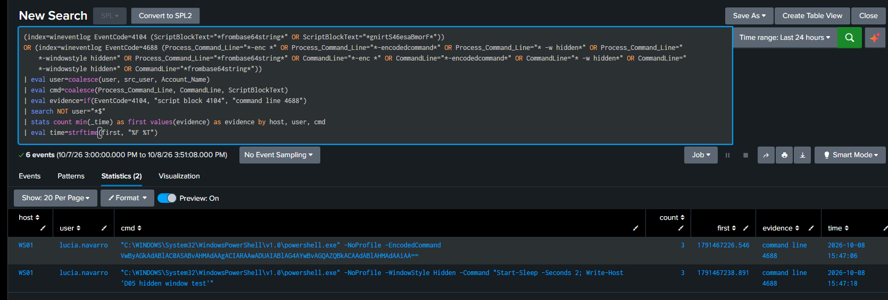

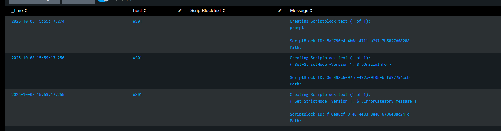

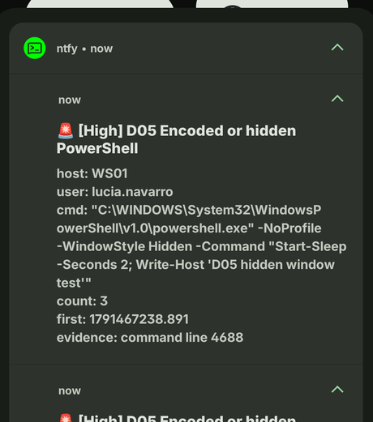

La lección se me quedó grabada: una detección que no devuelve nada justo después de atacar normalmente significa que estás leyendo el campo equivocado, no que el ataque haya sido silencioso. Ahora compruebo el campo antes de fiarme de la lógica.

**D09, Office lanzando una shell.** Abres una factura, salta una macro y Word, sin hacer ruido, abre una consola. Un documento normal nunca hace eso, así que Word o Excel como padre de una shell es una señal fuerte. En estas máquinas no hay Office instalado, así que probé la lógica con un sustituto: copié `cmd.exe` a un archivo llamado `winword.exe` y le hice lanzar una shell. La detección lo pilló y avisó, con el `winword.exe` falso como padre y `cmd.exe` como hijo. Lee dos fuentes de logs, Security 4688 y el evento 1 de Sysmon, así que pilla el proceso aunque una de las dos se lo pierda.

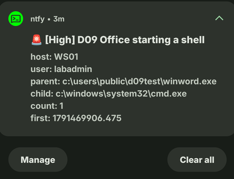

### Ir a por las llaves

**D06, un proceso abriendo la memoria de LSASS.** Este es el premio gordo para un atacante: LSASS es el proceso de Windows que guarda las credenciales de todos los que tienen la sesión iniciada, y leer su memoria es la forma en que herramientas como Mimikatz roban contraseñas. Esta es la única detección que no saltó, y resultó ser la mejor historia del proyecto.

Escribí una prueba pequeña que le pide a Windows un handle de lectura a LSASS, el acceso exacto que necesita un volcador, sin leer ni un solo byte de memoria. Me lo denegó. La lancé con privilegios elevados. Denegado. La lancé elevada y con el privilegio de depuración del que dependen los volcadores. Seguía denegado. El motivo estaba en el registro: `RunAsPPL = 2`. LSASS en estas máquinas corre como proceso protegido con un candado por UEFI, lo que quiere decir que el kernel rechaza el handle antes de que nada pueda tocarlo. Mimikatz, comsvcs y ProcDump chocan todos contra el mismo muro.

Así que D06 está hecha y es correcta, pero en estos equipos el sistema operativo corta el ataque antes de que arranque, y el intento rechazado es tan temprano que ni siquiera deja un evento que la detección pueda pillar. Encontré una defensa que funciona, no solo una detección que funciona, y eso es un resultado mejor. La detección sigue valiendo en cualquier equipo sin esa protección, o contra un atacante que intente desactivarla primero, lo cual hace mucho ruido por sí solo.

### Borrar las huellas

**D08, el registro de seguridad borrado.** Lo último que hace un intruso es borrar los logs. Casi nada legítimo borra el registro de seguridad de una máquina, así que cuando pasa avisa en Crítica. La parte que me gusta: borrar el log en la máquina no toca lo que el SOC ya tiene. Borré el registro de WS02 al final de una prueba, y Splunk seguía teniendo todos los eventos que la máquina había mandado antes del borrado, más el único evento que un borrado siempre escribe, diciendo quién lo hizo.

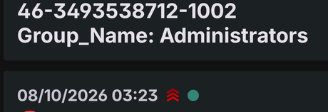

Esa es toda la gracia de mandar los logs fuera de la máquina: no puedes borrar lo que ya se ha ido.

### La tienda web

**D10, el WAF bloquea y luego deja pasar una.** Este es el puente con mi proyecto anterior. WEB01 es el WAF Flight Recorder, y su log de firewall entra en el mismo SOC. La detección busca muchos bloqueos desde un mismo origen sobre una misma página, y luego un acierto en esa misma página, que es la forma que tiene un atacante de machacar un formulario hasta que algo pasa. Una ráfaga de bloqueos desde una IP, luego un 200, y avisa.

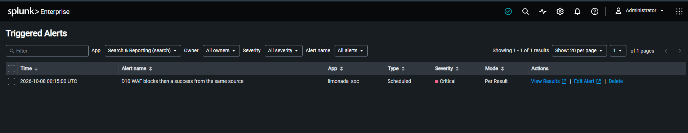

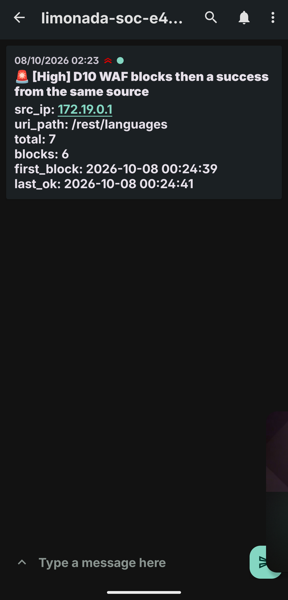

## El aviso al móvil

Las alertas no sirven de nada si no estoy mirando la pantalla, así que las serias me llegan al móvil. Una alerta de Splunk llama a un pequeño relé que escribí, que la reenvía a un topic privado de [ntfy](https://ntfy.sh) al que mi móvil está suscrito. Solo avisan las de severidad Alta y Crítica; las Medias se quedan en el dashboard, para que el móvil solo suene por cosas que merezcan levantarse. El nombre del topic es un secreto que no está en el repo, así que nadie más puede leer mis alertas.

## Lo que encontré

Las detecciones son lo importante, pero los hallazgos del camino son de lo que hablaría de verdad en una entrevista.

- **Sin política de bloqueo de cuentas.** El dominio nunca bloquea una cuenta tras contraseñas malas, así que adivinar y hacer spray sale barato. D01 y D02 son lo único que vigila esa puerta.
- **LSASS está protegido, y funciona.** `RunAsPPL = 2` con candado por UEFI frena el volcado de credenciales antes de que empiece, y tan temprano que el intento no deja rastro. Una defensa real ganándole a una técnica real, encontrada probando.
- **El log centralizado sobrevive a un borrado.** Borrar el log de una máquina no toca lo que el SOC ya guarda. D08 lo demostró.
- **El sensor tenía puntos ciegos, y los campos no estaban donde yo esperaba.** El acceso a LSASS no se estaba registrando de forma útil hasta que me puse a mirar, y los campos de los eventos en estas máquinas no eran los de Windows por defecto. Comprobar qué pinta tienen los datos de verdad, antes de fiarme de una búsqueda, es ahora el primer paso de cada detección que escribo.

## Cómo lo aprendí

Todavía estoy aprendiendo, así que lo monté como aprende mucha gente hoy en día: con Claude Code, un asistente de programación con IA, de tutor. Me ayudó a hacer los scripts del laboratorio, el montaje del dominio, las configuraciones y los primeros borradores de las detecciones. Lo usé para aprender el trabajo, no para saltármelo: hice correr Limonada S.L. en mis propias máquinas, lancé cada ataque, depuré cada detección que volvía vacía y saqué los hallazgos yo mismo.

Piénsalo como un profesor de autoescuela con dobles mandos. El profesor ayuda a sacar el coche a la carretera; el que está aprendiendo a conducir soy yo.

## Lo que me enseñó

Montar esto me aportó más que cualquier módulo de un curso, porque aquí nada funcionó a la primera y tuve que entender por qué.

- **Sé leer la telemetría de Windows.** Sé lo que me están diciendo un 4625, un 4688, un 4104, un 4698 y un 1102, y aprendí la lección más difícil: el campo que quieres no siempre está donde esperas. Dos veces una detección volvió vacía justo después de atacar, y las dos veces los datos estaban ahí, solo que en un campo que yo no estaba leyendo. Mirar el evento en crudo antes de fiarme de la búsqueda ya es una costumbre, no un paso.
- **Sé coger un ataque, mapearlo a ATT&CK y construir una detección para él.** Cada una de aquí tiene un ID de técnica, así que puedo describir lo que pilla en el idioma que usa de verdad un equipo SOC.
- **Aprendí la diferencia entre una detección que salta y una detección que importa.** D06 es el caso más claro: la búsqueda es correcta, pero la propia protección del equipo corta el ataque antes de que se pueda ver. Encontrar eso valió más que una alerta en verde.
- **Aprendí a afinar para quedarme con la señal.** Filtrar por quién hizo un cambio en vez de por dónde, silenciar repeticiones y mantener las detecciones tranquilas fuera del aviso, para que las fuertes sigan significando algo. Un busca que grita "que viene el lobo" acaba ignorado, y esa es una forma real de que un SOC falle.
- **Practiqué la mentalidad.** Darme cuenta de que faltaba la política de bloqueo, demostrar que el log centralizado sobrevive a un borrado, apuntar los agujeros en vez de taparlos sin decir nada. Ese instinto es lo que más quería construir, y es justo lo que a un becario lo contratan para empezar a aprender.

Esto no me convierte en un analista hecho y derecho. Me convierte en alguien que ha hecho el trabajo con sus propias manos y sabe explicar cada parte, que es desde donde quiero empezar.

## Hasta dónde lo llevaría

Las diez detecciones son el corazón de esto, y están hechas. Si sigo construyendo sobre ello, el camino ya está trazado:

- Una semana de ataques comprimida: cinco incidentes lanzados cada quince minutos sobre tráfico normal de fondo, cada uno trabajado y redactado como un informe de incidente.
- Wazuh como segundo SIEM corriendo la misma semana, para poder compararlo con Splunk lado a lado.
- Un sprint corto de Microsoft Sentinel para portar algunas detecciones a un tercer lenguaje de consultas.

Nada de eso cambia el núcleo, que está aquí y funcionando hoy.

## Límites

Esto es un laboratorio de prácticas para un analista, no seguridad real para una empresa real. Son un puñado de máquinas virtuales en un solo PC, no una red fortificada, y el SOC es una persona trabajando a mano, no Splunk Enterprise Security ni un equipo 24/7. Su valor está en la construcción y en entenderlo, no en la escala.

Todos los nombres de este laboratorio son inventados, y en las capturas no aparece ninguna IP ni ningún nombre de usuario reales.
